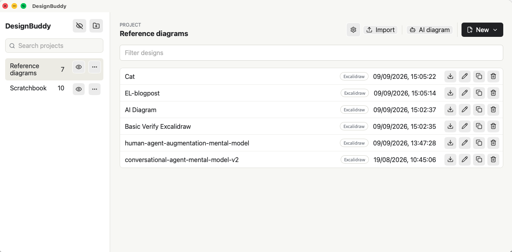
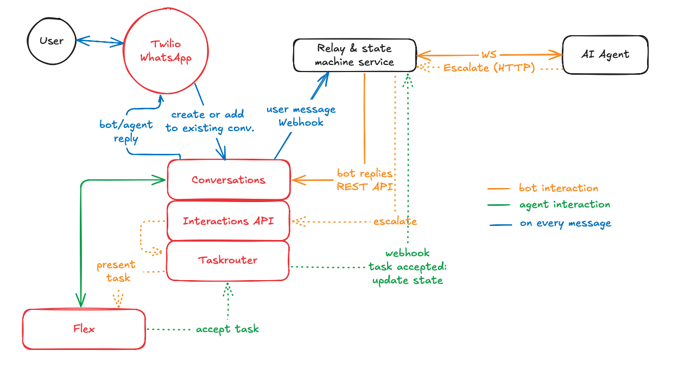
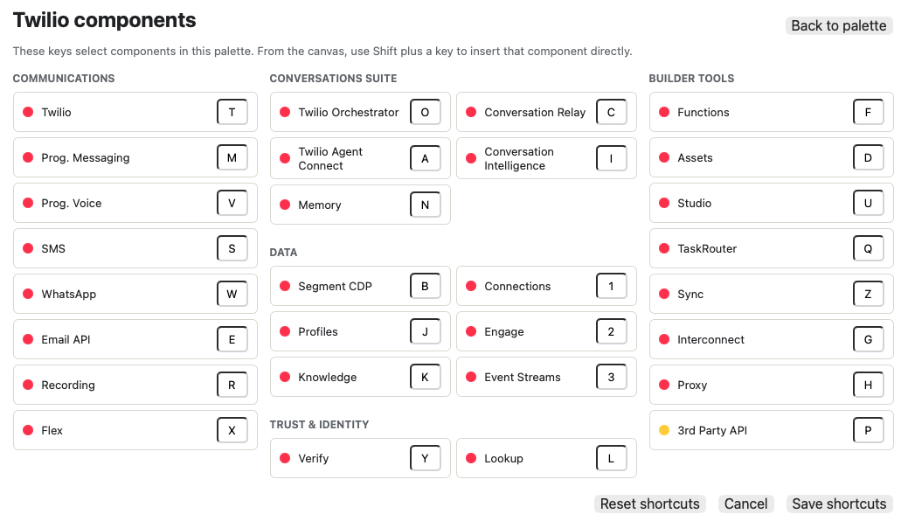

# DesignBuddy

DesignBuddy is a local-first desktop workspace for diagrams, Mermaid flowcharts, and notes. It combines a project library with an editable Excalidraw canvas, while keeping your work as ordinary files on your own computer.

DesignBuddy runs on macOS and Windows. No account, cloud sync, or remote storage is required for normal use.

## Quick start

1. [Install DesignBuddy](#install) for your platform.
2. Create a project, then choose **New → Excalidraw**, **Mermaid**, or **Note**.
3. Draw, write, import an existing file, or use **AI diagram** to start from a prompt.
4. Optionally add an OpenAI API key or compatible LiteLLM virtual key in **Settings** to enable AI features.
5. Use **Settings → Choose backup folder** to keep a copy of your library somewhere you control.

Everything you create is saved locally. AI requests and reference images only leave your computer when you explicitly start an AI action.

## What you can do

### Organize work

- Create, rename, duplicate, move, and delete projects and items.
- Search projects and filter items in the active project.
- Keep Excalidraw diagrams, Mermaid flowcharts, and rich-text notes together.
- Use presentation mode to hide private projects during screen sharing.

### Create diagrams and notes

- Draw with the embedded Excalidraw editor and save editable `.excalidraw` files.
- Create and edit Mermaid flowcharts as local `.mmd` files.
- Write rich-text notes as local `.bdnote` files.
- Convert supported simple Mermaid flowcharts into editable Excalidraw scenes.
- Insert ready-made Twilio architecture blocks into Excalidraw diagrams.

### Use AI assistance

- Generate editable Excalidraw scenes or Mermaid flowcharts from a prompt.
- Modify an existing Excalidraw or Mermaid diagram with a follow-up prompt.
- Attach a reference image to recreate or extend a diagram as editable elements.
- Choose **Reference draft** for a flexible image-informed sketch or **Clean architecture** for a structured, presentation-oriented architecture layout.

### Keep control of your data

- Autosave locally, with visible save status and a retry action if saving fails.
- Import existing Excalidraw, Mermaid, and DesignBuddy note files.
- Export individual items in their native formats; export Excalidraw diagrams as basic `.drawio` files for diagrams.net or Lucidchart handoff.
- Back up and restore the full local library from a folder you choose.
- On macOS, receive signed in-app update notices and review release notes before installing.

## Screenshots

### Project library



### Drawing editor



### Notes editor


### AI diagram prompt


### AI modification


### AI recommendation


### Mermaid editor and conversion


### Twilio components and settings




## Your files, backups, and privacy

### Local storage

Your project items are stored in your user Documents folder:

- macOS: `~/Documents/DesignBuddy/Designs`
- Windows: `C:\Users\<you>\Documents\DesignBuddy\Designs`

Each diagram, Mermaid file, and note remains a separate, portable file:

- Excalidraw diagrams: `.excalidraw`
- Mermaid flowcharts: `.mmd`
- DesignBuddy notes: `.bdnote`

DesignBuddy also keeps small, app-managed metadata files alongside relevant projects and diagrams. They preserve presentation visibility and a diagram's private Notes panel; they are not separate library items and are not included in a standard `.excalidraw` export.

No cloud sync, account, or remote storage is required. The OpenAI-compatible API key and optional base URL are saved locally in the app settings on that computer.

### Autosave and save problems

Edits autosave locally. The editor shows **Saving…** after a change and **Saved** only after the save has completed and been verified. If a save fails, the editor keeps the failure visible and offers **Retry save**.

For troubleshooting, DesignBuddy records save-failure metadata (not diagram content) in:

```text
Documents/DesignBuddy/Logs/save-failures.jsonl
```

### Backup and restore

Use **Settings → Choose backup folder** to select a folder you control, such as a Google Drive folder, then choose **Back up now** to copy the library there.

Restore lets you choose individual items from a backup before anything is written locally. If an item has the same project and filename as a local item, you can keep both—the default, using a conflict-safe copy name—replace the local item, or skip it. Restore never deletes local items, ignores invalid backup files, and preserves visibility settings for existing projects.

During a macOS in-app update, DesignBuddy also creates a dated backup in `Documents/DesignBuddy/Backups` before downloading the update. If that backup fails, the update does not start.

### Presentation mode

Presentation mode hides private projects from the sidebar while you screen share. Starting it automatically keeps the selected project visible; you can also use the eye button beside any project to mark a non-sensitive project as visible. Projects are private by default.

The project list and item table adapt to narrower windows so names, metadata, and row actions remain usable.

## Working with diagrams, flowcharts, and notes

### Excalidraw diagrams

Excalidraw is the default diagram type. DesignBuddy uses the embedded Excalidraw editor, so you retain the familiar sketch-style drawing workflow, editable canvas elements, library tools, and keyboard shortcuts.

DesignBuddy adds project organization, autosave, import and export, AI modification, Twilio templates, private diagram notes, and `.drawio` export around that canvas.

Press `N` while an Excalidraw canvas is focused to show or hide its private Notes panel. Use it for assumptions, open questions, and decisions that should follow the diagram without appearing as a separate library item.

### Mermaid flowcharts

Mermaid flowcharts are stored locally as `.mmd` files. Their editor provides a source pane, live preview, AI modification, import and export, and conversion to Excalidraw for supported diagrams.

Conversion intentionally focuses on simple `flowchart LR` and `flowchart TD` diagrams with basic nodes, arrows, chained arrows, and basic edge labels. Subgraphs, styling directives, class definitions, sequence diagrams, and advanced shapes are outside the current conversion scope.

Mermaid can be disabled in Settings if you prefer an Excalidraw-only workspace.

### Notes

Notes are lightweight rich-text items stored beside diagrams in the selected project. The TipTap-powered editor supports paragraphs and headings, bold and italic text, bulleted and numbered lists, block quotes, code blocks, undo and redo, autosave, and `.bdnote` import and export.

Use notes for discovery, customer context, architecture rationale, meeting summaries, or any context that should live beside the diagram it explains.

### Moving and copying items

Use **Duplicate** to copy an item into the current or another project. Use **Move** to relocate it. Both preserve a diagram's private Notes panel, refresh project counters, and never overwrite an existing item with the same name.

## AI assistance

AI features use your own OpenAI API key or a compatible LiteLLM virtual key. The default API base URL is OpenAI. For LiteLLM, enter its root URL or `/v1` URL; DesignBuddy uses the `/v1/responses` endpoint.

From the library, choose **AI diagram** to create a new diagram. You can select:

- **Excalidraw** for fully editable sketch-style diagrams
- **Mermaid** for compact structured flowcharts
- a model and quality level
- an optional reference image
- **Reference draft** or **Clean architecture** for image-informed Excalidraw output

From an open diagram, use the AI action to modify the current Excalidraw scene or Mermaid source.

AI requests are sent to OpenAI only when you explicitly use an AI action. Regular drawing, saving, import, export, backup, and project management work offline.

AI diagnostics are optional and stored locally. Enable them in Settings only when troubleshooting; you can download diagnostics as JSON, and raw model responses are included only when you explicitly opt in.

## Import and export

Import a `.excalidraw`, `.mmd`, or `.bdnote` file into the selected project. If its name already exists, DesignBuddy creates a conflict-safe copy instead of overwriting the existing item.

Use an item's editor **Export** menu for its full set of formats:

- Excalidraw diagrams: `.excalidraw` or basic `.drawio`
- Mermaid flowcharts: `.mmd`
- Notes: `.bdnote`

The project list also offers a quick export button for the item's native format. `.drawio` export is intended for practical handoff: common shapes, text, diamonds, ellipses, and arrows remain editable, while freehand strokes and advanced Excalidraw styling may not convert perfectly.

## Updates

### macOS

After the initial installation, DesignBuddy checks quietly for signed updates shortly after it opens. A small sidebar notice appears when one is available; select **Review update** to read the release notes and choose whether to install it. You can also use **Settings → Check for updates** at any time.

An update is never downloaded or installed until you select **Update to _version_**. Updates are verified against DesignBuddy's embedded public signing key. After a successful update, DesignBuddy restarts automatically.

### Windows

Windows installers are available through the Windows GitHub Actions build artifact. Signed in-app updating is currently available on macOS only, so Windows users should install newer builds from the artifact until Windows updater releases are published.

## Keyboard shortcuts

In the project library:

- `1` creates a note.
- `2` creates an Excalidraw diagram.
- `3` creates a Mermaid diagram when Mermaid is enabled.
- `Escape` cancels an open dialog.

In the note editor:

- `Cmd+B` / `Ctrl+B` toggles bold.
- `Cmd+I` / `Ctrl+I` toggles italic.

Inside Excalidraw, its standard shortcuts remain available for selection, shapes, drawing, text, and pan/hand mode.

For Twilio templates, press `§` to open the picker. `Cmd+Shift+T` is a keyboard-layout-friendly alternative. Once open, press a component's shown key badge to add it. Choose **Customize shortcuts** in the picker to change bindings.

To insert a component directly from the Excalidraw canvas, hold `Shift` and press its key badge. The Shift modifier leaves Excalidraw's usual unmodified shortcuts untouched.

## Twilio component templates

The Excalidraw editor includes a component picker for common Twilio architecture blocks. Components are grouped by product area and show their current keyboard binding:

- Communications: Twilio, Programmable Messaging, Programmable Voice, SMS, WhatsApp, Email API, Recording, Flex
- Trust & Identity: Verify, Lookup
- Conversations Suite: Twilio Orchestrator, Conversation Relay, Twilio Agent Connect, Conversation Intelligence, Memory
- Builder Tools: Functions, Assets, Studio, TaskRouter, Sync, Interconnect, Proxy, 3rd Party API
- Data: Segment CDP, Connections, Profiles, Engage, Knowledge, Event Streams

Twilio-owned blocks use Twilio red. External dependencies, such as `3rd Party API`, use a separate yellow style.

## Install

You do not need developer tools to run a downloaded build.

### macOS

Download the `DesignBuddy-macos` artifact from GitHub Actions. GitHub downloads a ZIP file; unzip it, open the included `.dmg`, and drag `DesignBuddy.app` into Applications.

If macOS warns that Apple could not verify the app, right-click the app in Applications and choose **Open**. This can happen because the app is ad-hoc signed but not notarized with an Apple Developer ID yet.

### Windows

Download the `DesignBuddy-windows` artifact from GitHub Actions. Open its `nsis` folder and run the `.exe` installer. The artifact also includes an `msi` folder for environments that prefer Windows Installer packages.

If Windows SmartScreen warns about the installer, choose **More info → Run anyway**. This can happen because the installer is not code-signed yet.

## Migrating from BanguesesDraw

DesignBuddy is the renamed version of BanguesesDraw. On first launch, it looks for an existing local library at `Documents/BanguesesDraw/Designs` and moves it to `Documents/DesignBuddy/Designs` when the new folder does not already exist.

Existing Excalidraw scenes, Mermaid diagrams, notes, AI settings, and backup settings remain compatible. Some internal markers and local settings keys keep the original `banguesesdraw` identifier so older artifacts continue to open cleanly.

## Developer notes

### Prerequisites

You only need these tools to run from source or build locally:

- Node.js 22 or newer
- npm
- Rust stable, with Cargo available on your terminal `PATH`
- Tauri system dependencies for your OS

Check Rust before running Tauri commands:

```bash
cargo --version
rustc --version
```

If Rust is unavailable, install it with rustup and restart your terminal:

```bash
curl --proto '=https' --tlsv1.2 -sSf https://sh.rustup.rs | sh
```

On macOS, install Xcode Command Line Tools if prompted:

```bash
xcode-select --install
```

On Windows, install Rust with its default MSVC toolchain. You may also need Microsoft Visual Studio Build Tools with the **Desktop development with C++** workload.

### Build from source

```bash
git clone https://github.com/rbangueses/DesignBuddy.git
cd DesignBuddy
npm ci
npm run tauri:dev
```

Build native bundles and installers:

```bash
npm exec tauri build
```

On macOS, build only the app bundle:

```bash
npm exec -- tauri build --bundles app
```

The local macOS app bundle is created in `src-tauri/target/release/bundle/macos/`. A local build also creates a DMG in `src-tauri/target/release/bundle/dmg/`.

Run the test suites:

```bash
npm run test:run
cargo test --manifest-path src-tauri/Cargo.toml
```

### GitHub Actions builds

The repository includes manually runnable GitHub Actions workflows for macOS and Windows builds:

```text
.github/workflows/macos-build.yml
.github/workflows/windows-build.yml
```

In GitHub, open **Actions**, choose **macOS Build** or **Windows Build**, select **Run workflow**, and download `DesignBuddy-macos` or `DesignBuddy-windows` when it finishes.

### App icon

The app icon comes from `src-tauri/icons/source-icon.png`. After changing it, regenerate the icon set:

```bash
node scripts/generate-designbuddy-icon.mjs
npm exec tauri icon -- src-tauri/icons/source-icon.png -o src-tauri/icons
```

The Tauri build script watches the key icon files so `npm run tauri:dev` refreshes icon resources after icon changes.

### Tech stack

- Tauri 2
- React, TypeScript, and Vite
- Excalidraw
- Mermaid
- TipTap
- Rust backend commands for local file storage

## License

Source-available, all rights reserved. The source code may be viewed, but may not be copied, modified, distributed, sublicensed, sold, hosted as a service, or otherwise used without prior written permission. See [LICENSE](LICENSE).
